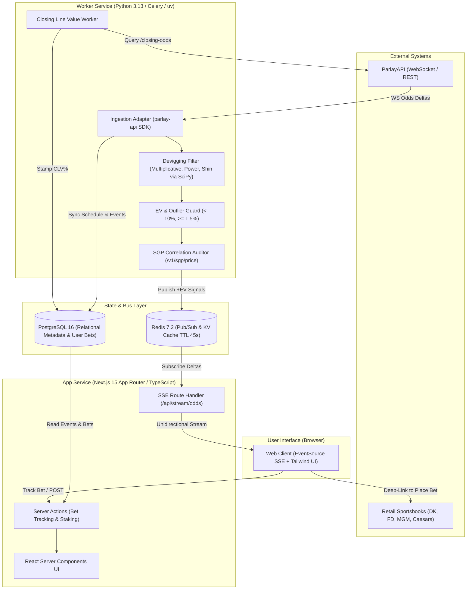

# Architecture Spine — ParlayPal

## 1. Design Paradigm

ParlayPal adheres to an **Event-Driven Pipes-and-Filters / Decoupled Polyglot** paradigm. 

The heavy quantitative ingestion and numerical computation is strictly decoupled from the presentation and user-facing API layer. Python acts as the ingestion and math filter, publishing verified +EV opportunities and odds deltas into a central Redis bus and PostgreSQL database. Next.js functions as the presentation and event stream gateway, consuming from Redis and PostgreSQL to serve authenticated users and stream live real-time feeds over HTTP/2 Server-Sent Events (SSE).

### Component Boundaries & Dependency Invariant



---

## 2. Invariants & Rules

### AD-1 — Polyglot Service Isolation [ADOPTED]
* **Binds:** Core Engine, Data Store, Web Layer
* **Prevents:** Mixing heavy numerical scientific computing (SciPy/NumPy root-solving) with Next.js web application threads, and hand-rolling numerical solvers in TypeScript.
* **Rule:** 
  1. The Python worker daemon owns all external interaction with `parlay-api.com` and all devigging calculations. It **never** handles incoming HTTP requests from end-user browsers.
  2. The Next.js application owns all user authentication, UI rendering, manual bet-logging writes, and SSE streaming. It reads odds from Redis and PostgreSQL, never directly calling ParlayAPI for live feeds.

### AD-2 — PostgreSQL 16 + Redis Ephemeral Hot-Layer [ADOPTED]
* **Binds:** Storage and persistence across all epics
* **Prevents:** Premature infrastructure complexity from exotic database extensions (TimescaleDB) during MVP, while preventing relational database write exhaustion from sub-second odds ticks.
* **Rule:**
  1. Live odds and +EV opportunities are stored in **Redis with a 45-second Time-To-Live (TTL)**.
  2. PostgreSQL 16 stores durable relational entities only: `events`, `teams`, `user_bets`, `clv_logs`, and `users`.
  3. Raw odds tick history is not permanently retained in PostgreSQL during Phase 1. If line-movement historical charts are requested, they query ParlayAPI’s `/v1/sports/{sport_key}/line-movement` or `/v1/historical/...` endpoints directly.

### AD-3 — Unidirectional Server-Sent Events (SSE) for Real-Time Odds [ADOPTED]
* **Binds:** Web Layer & Browser Client
* **Prevents:** Complex stateful WebSocket connection management, broken sticky sessions behind load balancers, and corporate firewall blocks for read-only odds updates.
* **Rule:**
  1. Live odds updates to the client must stream over HTTP/2 Server-Sent Events (`/api/stream/odds`) using standard browser `EventSource`.
  2. User actions (e.g., clicking "Track Bet", adjusting bankroll) are executed as standard stateless REST POST requests / Next.js Server Actions.
  3. The SSE endpoint subscribes directly to Redis Pub/Sub channels (`odds:feed:<sport_key>`) and pushes JSON event frames to the browser.

### AD-4 — Multi-Method Devigging & Outlier Bounds [ADOPTED]
* **Binds:** Devigging Engine (Epic 1)
* **Prevents:** Misleading +EV signals caused by devigging model artifacts or stale/erroneous sportsbook data feeds.
* **Rule:**
  1. Every two-way line is devigged using Multiplicative and Power (solved via Brent's method: $\sum P_i^k = 1.0$).
  2. Moneylines and player props must calculate EV using the **Power method** as primary, but will display the minimum EV across both methods:
     $$\text{EV}_{\text{guarded}} = \min(\text{EV}_{\text{mult}}, \text{EV}_{\text{power}})$$
  3. **Outlier Guard:** Any bet with calculated $\text{EV} > 10.0\%$ must be flagged as `SUSPECT_STALE_LINE` and excluded from the public "Best Bets" feed to prevent users from betting into lines that will be voided.
  4. Minimum threshold for inclusion on the "Best Single Bets" feed is $\text{EV} \ge 1.5\%$.

### AD-5 — Dual-Path Parlay Valuation (Independent vs. SGP) [ADOPTED]
* **Binds:** Parlay Engine (Epic 2)
* **Prevents:** Applying naive independent multiplication to intra-game correlated legs, and hand-rolling uncalibrated copula models.
* **Rule:**
  1. **Cross-Game Parlays:** Independent events across different games are priced as:
     $$P_{\text{parlay\_fair}} = \prod_{i=1}^n P_{\text{fair}, i}$$
  2. **Same-Game Parlays (SGPs):** Any parlay combining selections from the *same* `event_id` must call ParlayAPI’s `POST /v1/sgp/price` endpoint. The engine stores and displays the returned `correlation_audit[]` metadata to show the user the exact correlation factor.

### AD-6 — Asynchronous Event-Commence CLV Engine [ADOPTED]
* **Binds:** Bet Tracking & Settlement (Epic 4)
* **Prevents:** Maintaining brittle 24/7 scrapers on game start or missing closing line calculations.
* **Rule:**
  1. When a user tracks a bet, it is recorded in `user_bets` with status `pending` and execution odds $D_{\text{exec}}$.
  2. A scheduled Celery/BullMQ task triggers 10 minutes after `commence_time`, calling:
     `GET /v1/historical/sports/{sport_key}/closing-odds?event_id={event_id}`
  3. The worker devigs the closing sharp price via the Power method, calculates:
     $$\text{CLV}\% = (P_{\text{fair, close}} \times D_{\text{exec}}) - 1$$
  4. The result is stamped into `user_bets.closing_fair_prob` and `user_bets.clv_percentage`.

---

## 3. Consistency Conventions

| Concern | Convention | Standard |
| :--- | :--- | :--- |
| **Identifies & UUIDs** | Canonical UUID v4 for internal database entities | `event_id`, `bet_id`, `user_id` |
| **Provider Mapping** | Explicit provider mapping prefix | External ParlayAPI IDs stored in `external_id` (e.g. `papi_nfl_12345`) |
| **Odds Formats** | Decimal internal standard | All internal math uses Decimal odds ($D \ge 1.01$). American odds ($+150, -110$) are converted at ingestion and display boundaries only. |
| **Timestamps** | ISO 8601 UTC with timezone | `TIMESTAMPTZ` in Postgres, `YYYY-MM-DDTHH:mm:ssZ` across APIs and Redis |
| **Redis Keys** | Namespaced with colons | `odds:latest:{sport_key}:{event_id}`, `ev:feed:{sport_key}`, `sgp:audit:{event_id}` |
| **Error Handling** | Standardized JSON Problem Details | `{ error: { code: "OUT_OF_USAGE_CREDITS", message: "...", retry_after: 60 } }` |

---

## 4. Stack Seed

| Layer | Technology | Pinned Version | Purpose |
| :--- | :--- | :--- | :--- |
| **Worker Runtime** | Python | 3.13 | High-throughput quant calculations, worker daemons |
| **Worker Packages** | `parlay-api`, `scipy`, `pydantic` | `parlay-api>=0.2.0`, `scipy>=1.13.0` | ParlayAPI SDK, Brent root-solver for devigging |
| **Web Runtime** | Node.js | 22 LTS | Fast server runtime for Next.js |
| **Web Framework** | Next.js | 15.x (App Router) | Server Components, SSE streaming, authentication |
| **Styling** | Tailwind CSS | 4.x | Mobile-first quantitative dashboard UI |
| **Cache & Bus** | Redis | 7.2 | Sub-millisecond hot odds cache and Pub/Sub channel |
| **Primary Database**| PostgreSQL | 16 | Relational data: events, user bets, CLV history |
| **Task Queue** | Redis + Celery / BullMQ | Latest | Asynchronous closing line polling and settlement |

---

## 5. Structural Seed & Data Schema

### Relational Schema (PostgreSQL 16)

```sql
-- Events Metadata
CREATE TABLE events (
    event_id UUID PRIMARY KEY DEFAULT gen_random_uuid(),
    external_provider_id VARCHAR(64) UNIQUE NOT NULL,
    sport_key VARCHAR(32) NOT NULL,
    league_name VARCHAR(32) NOT NULL,
    home_team VARCHAR(64) NOT NULL,
    away_team VARCHAR(64) NOT NULL,
    commence_time TIMESTAMPTZ NOT NULL,
    status VARCHAR(20) DEFAULT 'pre_match' CHECK (status IN ('pre_match', 'live', 'completed', 'canceled')),
    created_at TIMESTAMPTZ NOT NULL DEFAULT NOW()
);

CREATE INDEX idx_events_sport_commence ON events(sport_key, commence_time);

-- 1-Click Tracked User Bets & CLV
CREATE TABLE user_bets (
    bet_id UUID PRIMARY KEY DEFAULT gen_random_uuid(),
    user_id UUID NOT NULL,
    event_id UUID REFERENCES events(event_id),
    sportsbook_name VARCHAR(32) NOT NULL,
    bet_type VARCHAR(20) NOT NULL CHECK (bet_type IN ('single', 'multi_leg', 'sgp')),
    market_key VARCHAR(64) NOT NULL,
    selection_name VARCHAR(128) NOT NULL,
    line_value NUMERIC(6,2),
    odds_placed_decimal NUMERIC(8,4) NOT NULL,
    stake_amount NUMERIC(10,2) NOT NULL,
    kelly_recommended_stake NUMERIC(10,2),
    initial_fair_prob NUMERIC(6,5) NOT NULL,
    initial_ev_pct NUMERIC(6,3) NOT NULL,
    closing_fair_prob NUMERIC(6,5),
    clv_percentage NUMERIC(6,3),
    settlement_status VARCHAR(20) DEFAULT 'pending' CHECK (settlement_status IN ('pending', 'won', 'lost', 'push', 'void')),
    placed_at TIMESTAMPTZ NOT NULL DEFAULT NOW(),
    settled_at TIMESTAMPTZ
);

CREATE INDEX idx_user_bets_user_placed ON user_bets(user_id, placed_at DESC);
CREATE INDEX idx_user_bets_event_pending ON user_bets(event_id, settlement_status) WHERE settlement_status = 'pending';
```

---

## 6. Deferred Decisions

The following items are deliberately deferred to maintain focus and ship the core value proposition:

1. **TimescaleDB Hypertables:** Deferred until odds tick data volume exceeds 10M rows/day.
2. **Automated Credentialed Bet Sync (SharpSports):** Deferred to Phase 2; replaced with frictionless 1-Click Track in Phase 1.
3. **Custom In-House SGP Copula Engine:** Deferred indefinitely; handled cleanly by ParlayAPI `/v1/sgp/price`.
4. **Native Mobile App (React Native/Flutter):** Deferred; Next.js responsive web application satisfies all target user scenarios.
