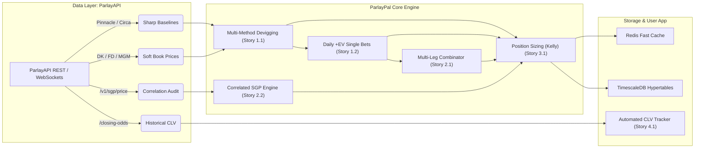

# Technical Research: ParlayAPI Integration & Architectural Feasibility

**Decision this research serves:** Adopt ParlayAPI (`parlay-api.com`) as the foundational odds, player prop, and devigging data provider for the ParlayPal quantitative betting engine.

---

## 🏛️ Executive Summary & Recommendation

**Recommendation: APPROVED for Phase 1 MVP and Production Scaling.**

ParlayAPI is exceptionally well-suited for ParlayPal's quantitative betting architecture. Crucially, the technical reconnaissance revealed that **ParlayAPI already provides a dedicated Same-Game Parlay endpoint (`/v1/sgp/price`) with an internal correlation auditor**, completely de-risking the heaviest mathematical obstacle in our backlog (Story 2.2). Furthermore, its drop-in compatibility with *The Odds API (v4)* schema and support for Pinnacle baseline data and historical closing lines allows ParlayPal to execute Epics 1, 2, 4.1, and 5 with minimal data transformation overhead.



---

## 1. Dimension 1: API Endpoints, Sharp Coverage & Payload Compatibility

### Verification Findings
* **Standard V4 Drop-In Interface:** The API root (`https://parlay-api.com`) closely mirrors *The Odds API* v4 request structure and parameter taxonomy.
* **Sharp Benchmark Presence:** Pinnacle (`pinnacle`) and Novig (`novig`) are accessible, providing the true low-margin benchmark odds required for Multiplicative, Power, and Shin devigging algorithms (Story 1.1).
* **Retail & Alternative Books:** Aggregates 30–45+ sportsbooks, notably:
  * US Retail Sportsbooks: DraftKings, FanDuel, BetMGM, Caesars, bet365, BetRivers.
  * Prediction Markets: **Kalshi** and **Polymarket** are exposed directly as bookmaker objects, enabling innovative devigging against decentralized event contracts.
  * DFS Pick'em Apps: PrizePicks, Underdog, Sleeper, Betr, and ParlayPlay.
* **Payload Structure:** Returns standard clean JSON:
  ```json
  {
    "id": "e4f8a123bc456",
    "sport_key": "americanfootball_nfl",
    "commence_time": "2026-11-08T18:00:00Z",
    "home_team": "Kansas City Chiefs",
    "away_team": "Buffalo Bills",
    "bookmakers": [
      {
        "key": "pinnacle",
        "title": "Pinnacle",
        "last_update": "2026-11-07T17:15:00Z",
        "markets": [
          {
            "key": "spreads",
            "outcomes": [
              { "name": "Kansas City Chiefs", "price": 1.952, "point": -2.5 },
              { "name": "Buffalo Bills", "price": 1.952, "point": 2.5 }
            ]
          }
        ]
      }
    ]
  }
  ```

---

## 2. Dimension 2: Streaming, Latency & Credit Economics

### Pricing & Quota Breakdown
ParlayAPI utilizes a predictable, credit-metered model with no surprise overages (exhausted keys return `HTTP 403 OUT_OF_USAGE_CREDITS`):

| Tier | Price | Monthly Credits | Key Features & Limits | Recommended Phase |
| :--- | :--- | :--- | :--- | :--- |
| **Free** | $0/mo | 1,000 | 2-day historical data, REST only | Local prototype / schema tests |
| **Starter** | $5/mo | 20,000 | 7-day historical window | Dev integration & initial tests |
| **Pro** | $20/mo | 100,000 | 30-day historical window, line movement API | Alpha testing / small staging |
| **Business** | $40/mo | 1,000,000 | WebSockets + SSE, 90-day history, priority support | **Production MVP launch** |

### Consumption Mechanics
* **Game-Line Odds:** Billed as `billable_markets × regions` (e.g., requesting US Moneylines + Spreads costs 2 credits).
* **Rate Limits:** Paid tiers feature **no rigid per-second rate limits**, enabling fast parallel bursts up to an app-safety ceiling of 10,000 rps.
* **Streaming Architecture:** The Business tier ($40/mo) provides WebSocket streams (`wss://parlay-api.com/v1/ws/odds/{sport_key}`). This delivers an initial snapshot followed by low-latency delta `odds_update` frames. Streaming drastically reduces credit consumption and database write churn compared to high-frequency polling.

---

## 3. Dimension 3: Same-Game Parlay (SGP) Pricer & Correlation Modeling

### The Breakthrough Finding
The initial technical risk identified during analysis was the absence of a correlation engine for Story 2.2. ParlayAPI directly resolves this via its **dedicated SGP pricer endpoint**:

* **Endpoint:** `POST https://parlay-api.com/v1/sgp/price`
* **Mechanism:** Accepts an array of game selections (e.g., *Patrick Mahomes Over 280.5 Passing Yards* + *Travis Kelce Over 6.5 Receptions* + *Chiefs Moneyline*) and computes the correlation-adjusted fair price.
* **Correlation Audit:** The response includes `correlation_audit[]`, providing mathematical correlation coefficients between each leg pair:
  ```json
  {
    "sgp_fair_price_decimal": 3.42,
    "sgp_fair_prob": 0.2924,
    "unadjusted_prob": 0.2215,
    "correlation_audit": [
      {
        "leg_1": "Patrick Mahomes Over 280.5 Pass Yds",
        "leg_2": "Travis Kelce Over 6.5 Rec",
        "correlation_coefficient": 0.48,
        "impact": "positive_correlation"
      }
    ]
  }
  ```
* **Impact on Backlog:** Story 2.2 can be delivered in Phase 1 by comparing `/v1/sgp/price` against retail book promotional multipliers or scraped boost quotes, avoiding months of in-house copula model training.

---

## 4. Dimension 4: Historical Closing Lines (CLV) & SDK Integration

### Closing Line Verification (Story 4.1)
* **Endpoint:** `GET /v1/historical/sports/{sport_key}/closing-odds`
* **Pricing:** Flat 10 credits per call.
* **Implementation Pattern:**
  1. User wagers are saved to `user_bets` with execution odds `odds_placed_decimal`.
  2. When the match commences, a background BullMQ / Celery worker triggers this endpoint.
  3. The sharp closing probability is retrieved and devigged via the Power method to compute:
     $$\text{CLV}\% = (P_{\text{fair, close}} \times D_{\text{exec}}) - 1$$
  4. The result is permanently committed to `user_bets.clv_percentage`.

### Official Python SDK
The official `parlay-api` Python package (`pip install parlay-api`) provides first-class support for scripts, worker daemons, and Model Context Protocol (MCP) tooling:
```python
import os
from parlay_api import ParlayAPI

client = ParlayAPI(api_key=os.environ.get("PARLAY_API_KEY"))

# Fetch upcoming NFL mainlines & props
events = client.odds("americanfootball_nfl", regions="us", markets="h2h,spreads,totals")
```

---

## 5. Architectural Blueprint for ParlayPal

```
[ ParlayAPI WebSocket / SSE ] 
       │
       ▼ (Delta Odds Updates)
[ Ingestion Worker (Node.js / Python) ]
       │
       ├─► [ Redis Pub/Sub & Key-Value Cache (TTL 45s) ] ──► [ Next.js Frontend ]
       │
       ├─► [ Devigging Engine (Multiplicative, Power, Shin) ]
       │         │
       │         ▼
       │   [ +EV Screener & SGP Combinator ] ──► [ "Best Bets of the Day" Feed ]
       │
       └─► [ TimescaleDB Hypertable (`odds_ticks`) ] (Batched writes on price change)
```

---

## 6. Actionable Decisions & Next Steps

1. **Vendor Selection:** Lock in **ParlayAPI** as the primary data vendor for ParlayPal.
2. **Tier Strategy:**
   - Free/Starter tier ($0–$5) for local test harness and unit testing devigging algorithms.
   - Business tier ($40/mo) for Staging/Production to unlock WebSockets and minimize credit burn.
3. **Sprint Plan Handoff:**
   - Update **Story 1.1 & 1.2** with ParlayAPI v4 schema mappings.
   - Update **Story 2.2** to integrate directly with `/v1/sgp/price`.
   - Update **Story 4.1** to leverage `/v1/historical/sports/{sport_key}/closing-odds`.
   - Proceed to **Winston (System Architect / `bmad-agent-architect`)** to generate the comprehensive system architecture document and database schema migration.
