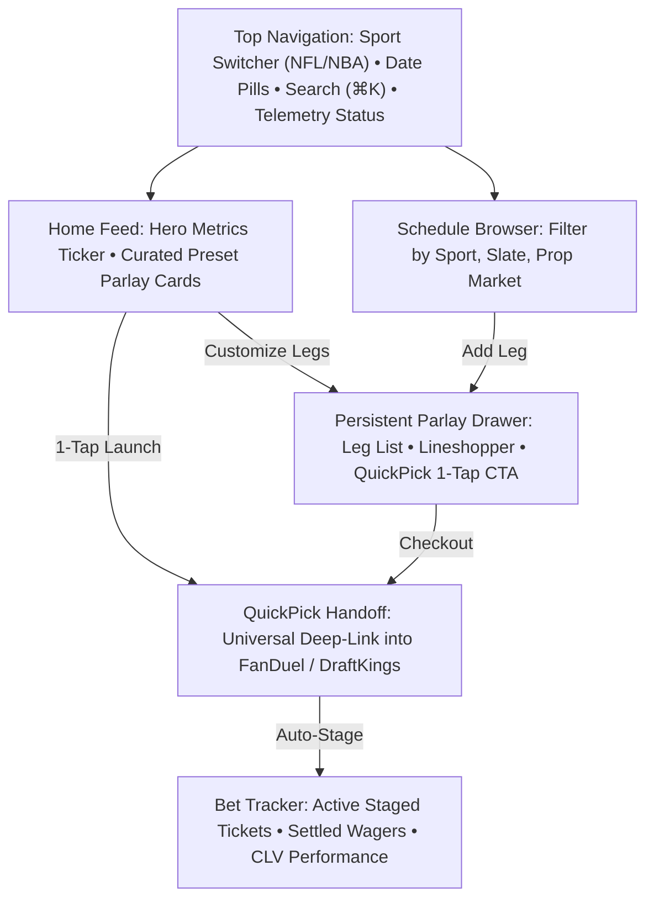

# ParlayPal — User Experience, Interactions & Journeys

## 1. Information Architecture & Navigation

---

## 2. Interaction Patterns & Micro-Behaviors

### 2.1 Preset Discovery to 1-Tap Handoff (The 60-Second Loop)
1. **Entry:** User opens ParlayPal. Preset cards are rendered above the fold with glowing odds badges.
2. **Scannability:** The eye scans:
   - Green form dots (`🟢🟢🟢🟢🔴`) validate recent consistency.
   - Yellow badge (`⚠️ 22mph wind`) provides situational risk awareness.
   - Payout badge (`+485`) confirms upside.
3. **Execution:** User clicks *"Open in Sportsbook via QuickPick"*.
   - Button enters loading state with spinning cyan glow ($\le 1.5\text{s}$).
   - QuickPick deep link triggers sportsbook app open on mobile or new browser tab on desktop.
   - ParlayPal displays an unobtrusive bottom toast: *"Slip sent to FanDuel & staged in your Bet Tracker"*.

### 2.2 Leg Customization Flow
1. User clicks *"Customize Legs"* on a preset card.
2. The card animates into an active editing state, and the Persistent Parlay Drawer expands.
3. Removing a leg triggers a smooth fade-out and slide-up of remaining legs; combined odds recalculate in real-time.
4. Tapping *"Swap Leg"* opens a sliding modal listing alternative candidates matching the sport and slate, ranked by Hybrid Value Score.
5. Selecting a candidate swaps the leg with a green flash animation (`#10b981`), recalculating combined payout and SGP correlation factors.

### 2.3 Lineshopper Widget Interaction
- As legs are added or changed, the Lineshopper component queries current lines across FanDuel, DraftKings, BetMGM, and Caesars.
- The book with the highest combined payout is emphasized with a bold green outline and the calculated edge (e.g. `+$55 Edge over DraftKings`).
- The user can click any sportsbook logo in the widget to change the target book for the QuickPick deep link.

---

## 3. Responsive States & Breakpoints
- **Desktop ($\ge 1280\text{px}$):** 3-column command layout. Left sidebar for navigation and filters, center canvas for cards and feeds, sticky right rail (360px) for the active Parlay Drawer.
- **Tablet ($768\text{px} - 1279\text{px}$):** 2-column layout. Left nav collapses into top horizontal chip bar. Parlay Drawer docks to a dynamic bottom sheet.
- **Mobile ($< 768\text{px}$):** 1-column stream. Matchup and preset cards span full viewport width. The Parlay Drawer rests as a compact sticky bottom bar showing legs count and odds, with a swipe-up gesture revealing the full slip and lineshopper.
